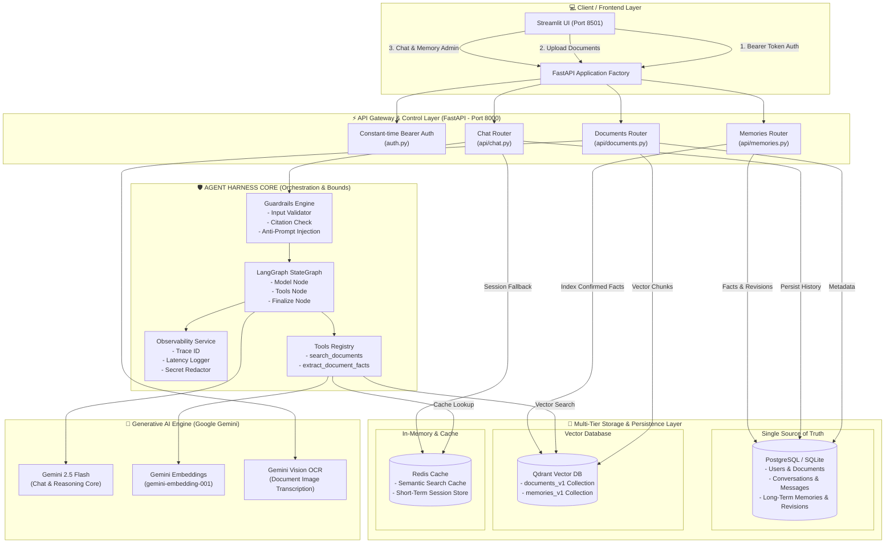
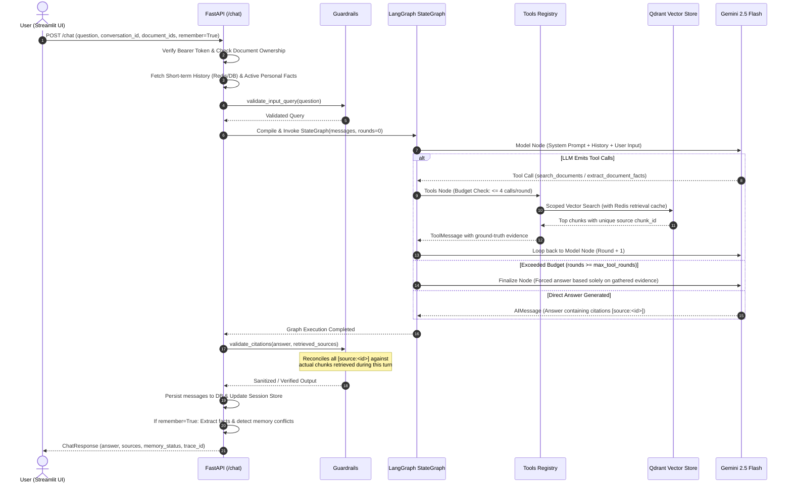
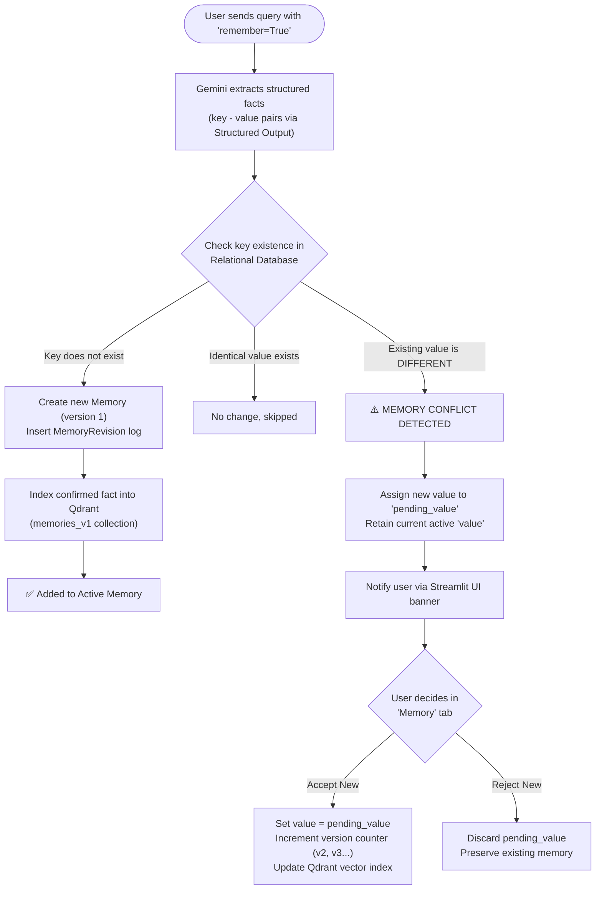
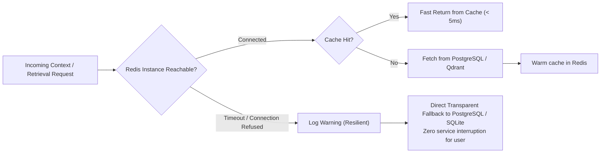

# 🤖 Agent Harness Document AI Chatbot

[](https://www.python.org/)
[](https://fastapi.tiangolo.com/)
[](https://github.com/langchain-ai/langgraph)
[](https://streamlit.io/)
[](https://qdrant.tech/)
[](https://redis.io/)
[](https://www.docker.com/)
[](tests/)

An enterprise-grade intelligent Document AI Assistant engineered with the **Agent Harness Architecture**. 
## 🎬 Demo

Unlike naive RAG pipelines that merely concatenate raw text into LLM prompts, this system encapsulates the foundational reasoning engine (**Google Gemini LLM**) within an operational infrastructure (**Harness**), providing strict bounds, runtime guarantees, and production resilience:

> **Agent Harness = LLM Core + Typed Tools + Dual Memory + Execution Environment + Guardrails + Observability**

- 🛠️ **Tools Execution Environment:** Strictly schema-bounded tools (`search_documents`, `extract_document_facts`) with execution budgets (maximum 4 calls/round, 3 rounds max).
- 🧠 **Dual-Tier Memory System:** Short-term conversation session context (Redis with relational DB fallback) paired with Long-term factual memory featuring schema-enforced revision history and human-in-the-loop conflict resolution.
- 🛡️ **Multi-Layer Guardrails:** Anti-Prompt Injection filters, strict timeout/retry limits, and **cryptographically verifiable citation guardrails** that reject hallucinated citations.
- 📊 **Zero-Leak Observability:** End-to-end tracing with unique `Trace ID`s, granular latency breakdown, and automated redaction of API keys, passwords, and tokens from all logs.
- 🔄 **Fault Tolerance & Dual Modes:** Zero-dependency **Standalone Local Mode** (SQLite + embedded disk Qdrant) for instant developer onboarding, alongside a full **Production Microservices Stack** via Docker Compose.

---

## 📑 TABLE OF CONTENTS
1. [System Architecture](#-system-architecture)
2. [The 5 Core Pillars of Agent Harness](#-the-5-core-pillars-of-agent-harness)
3. [Execution Workflows](#-execution-workflows)
   - [LangGraph Agent Execution Loop](#1-langgraph-agent-execution-loop)
   - [Long-Term Memory & Conflict Resolution](#2-long-term-memory--conflict-resolution)
   - [Fault Tolerance & Fallback Strategy](#3-fault-tolerance--fallback-strategy)
4. [Repository Structure](#-repository-structure)
5. [Key Features](#-key-features)
6. [API Reference](#-api-reference)
7. [Environment Variables (.env)](#-environment-variables-env)
8. [Installation & Getting Started](#-installation--getting-started)
   - [Method 1: One-Command Standalone Local Run (Recommended for Dev)](#method-1-one-command-standalone-local-run-recommended-for-dev)
   - [Method 2: Multi-Service Docker Compose Stack](#method-2-multi-service-docker-compose-stack)
   - [Method 3: Manual Step-by-Step Launch](#method-3-manual-step-by-step-launch)
9. [Automated Testing (Pytest)](#-automated-testing-pytest)
10. [Cloud Deployment (Fly.io)](#-cloud-deployment-flyio)
11. [Troubleshooting Guide](#-troubleshooting-guide)
12. [Current Limitations & Future Improvements](#-current-limitations--future-improvements)
13. [Author & License](#-author--license)

---

## 🏛️ SYSTEM ARCHITECTURE

The platform is designed with clear separation of concerns across clients, APIs, agent orchestration, and multi-tier storage:



---

## 🛡️ THE 5 CORE PILLARS OF AGENT HARNESS

The **Agent Harness** architecture encapsulates the core LLM with strict perimeter defenses and execution guarantees:

| Pillar | Architectural Role | Responsible Components |
| :--- | :--- | :--- |
| **1. Tools Environment** | Provides strictly typed tools (`SearchArgs`, `ExtractArgs`). Enforces runtime budgets: max **4 tool calls per round**, max **3 reasoning rounds** (`max_tool_rounds`), preventing infinite recursion or budget overrun. | `backend/agent/tools.py`<br>`backend/agent/graph.py` |
| **2. Dual-Tier Memory** | Two-tiered memory: **Short-Term Session** (Redis cache with automatic fallback to relational DB) and **Long-Term Factual Store** (version-controlled user facts with proactive conflict detection). | `backend/services/sessions.py`<br>`backend/services/memory.py` |
| **3. Guardrails Engine** | Perimeter defense: Input size & sanitization; prompt injection override neutralization (`sanitize_reference_content`); and **Strict Citation Verification** (`validate_citations`) ensuring every cited `[source:<id>]` exists in retrieved chunks. | `backend/agent/guardrails.py` |
| **4. Zero-Leak Observability** | Every request is assigned a `Trace ID`. Detailed millisecond-level step latencies and token usage are logged, while all tokens, passwords, and secrets are automatically masked (`[REDACTED]`). | `backend/services/observability.py` |
| **5. Storage & Ingestion** | Robust multimodal parser (PDF, TXT, MD, PNG, JPG) with on-demand OCR via Gemini Vision. Relational data is stored in PostgreSQL/SQLite while high-dimensional vectors are indexed in Qdrant with tenant isolation. | `backend/services/ingestion.py`<br>`backend/services/vectors.py` |

---

## 🔄 EXECUTION WORKFLOWS

### 1. LangGraph Agent Execution Loop

The end-to-end lifecycle of a user query through the LangGraph StateGraph:



---

### 2. Long-Term Memory & Conflict Resolution

Core safety principle: **Conflicting personal facts are NEVER silently overwritten without explicit user approval.**



---

### 3. Fault Tolerance & Fallback Strategy

The system is architected for **Graceful Degradation** under infrastructure degradation or container downtime:



---

## 📂 REPOSITORY STRUCTURE

```
chatbot/
├── app.py                      # Streamlit UI (Chat, Document Manager, Memory Resolver, Tracing)
├── run.py                      # One-click launcher starting both FastAPI Backend & Streamlit UI
├── start.bat                   # Windows batch file for instant double-click launch
├── server.py                   # Backward-compatible ASGI entry point for uvicorn server:app
├── requirements.txt            # Pinned Python dependencies
├── .env.example                # Configuration template
├── .env                        # Local configuration file (ignored by git)
├── .gitignore                  # Prevents leakage of credentials, SQLite DB, and caches
├── .dockerignore               # Optimizes Docker build cache and size
├── Dockerfile                  # Production container definition (Python 3.11 slim)
├── compose.yaml                # Multi-service stack: API, UI, PostgreSQL 17, Redis 7, Qdrant
├── fly.toml                    # Cloud deployment config for Backend API
├── fly.ui.toml                 # Cloud deployment config for Streamlit Frontend
├── pytest.ini                  # Pytest environment configuration
├── README.md                   # System documentation & technical reference
│
├── backend/                    # CORE BACKEND ENGINE (FastAPI & Agent Harness)
│   ├── __init__.py
│   ├── main.py                 # FastAPI application factory, Lifespan, and Health endpoints
│   ├── config.py               # Pydantic Settings, UTF-8 BOM safe loader, strict token validation
│   ├── auth.py                 # Constant-time Bearer token authentication (prevents timing attacks)
│   ├── database.py             # SQLAlchemy engine & session factory (PostgreSQL / SQLite)
│   ├── models.py               # ORM Models: Document, Conversation, Message, Memory, Revision
│   ├── schemas.py              # Pydantic request/response schemas
│   │
│   ├── api/                    # REST API ROUTERS
│   │   ├── __init__.py
│   │   ├── deps.py             # Route dependencies: Exclusive operation lock, entity ownership check
│   │   ├── documents.py        # Upload, chunk, index, list, and delete documents
│   │   ├── conversations.py    # Create, list, delete conversations and message histories
│   │   ├── chat.py             # Primary RAG Q&A endpoint executing Agent Harness
│   │   └── memories.py         # Long-term factual memory CRUD and conflict resolution
│   │
│   ├── agent/                  # AI AGENT HARNESS (LANGGRAPH)
│   │   ├── __init__.py
│   │   ├── graph.py            # LangGraph StateGraph: model -> tools -> finalize -> guardrails
│   │   ├── guardrails.py       # Input validation, prompt injection neutralizer, citation verifier
│   │   ├── tools.py            # Search and fact extraction tools bound to request context
│   │   ├── state.py            # TypedDict schema defining AgentState
│   │   └── prompts.py          # Grounded System Prompt enforcing strict boundaries
│   │
│   └── services/               # MODULAR BUSINESS LOGIC SERVICES
│       ├── __init__.py
│       ├── gemini.py           # Gemini 2.5 Flash, Multimodal Vision, Embeddings & Structured Output
│       ├── ingestion.py        # Document parsing (PDF, TXT, MD, Images) and semantic chunking
│       ├── vectors.py          # Qdrant client: Tenant filtering, batch upserting, cosine similarity
│       ├── sessions.py         # Conversation session manager (Redis with automatic DB fallback)
│       ├── cache.py            # Redis semantic retrieval cache with SHA-256 key hashing
│       ├── memory.py           # Fact persistence, revision tracking, conflict resolution logic
│       ├── facts.py            # Specialized extraction delegator for user vs document facts
│       └── observability.py    # TraceRecorder capturing step latencies with secret redaction
│
├── tests/                      # AUTOMATED TEST SUITE (20/20 PASSING)
│   ├── __init__.py
│   ├── conftest.py             # Fixtures: In-memory SQLite, isolated mocks, test configurations
│   ├── mocks.py                # Deterministic Mock Gemini and Mock Embeddings (no API costs)
│   ├── test_agent.py           # LangGraph loop, citation enforcement, prompt sanitization tests
│   ├── test_auth.py            # Constant-time auth verification and 401 rejection tests
│   ├── test_documents.py       # Upload validation, page limit, chunking, and deletion tests
│   ├── test_memory.py          # Fact addition, conflict detection, resolution, and revision tests
│   └── test_retrieval.py       # Vector search, cache fallback, and Redis disconnection resilience tests
│
└── .github/
    └── workflows/
        └── ci.yml              # GitHub Actions CI workflow executing pytest on push/PR
```

---

## ✨ KEY FEATURES

### 1. Multimodal Document Parsing & Smart OCR
- Supports `.pdf`, `.txt`, `.md`, `.markdown`, `.png`, `.jpg`, and `.jpeg`.
- **Cost-Optimized OCR:** PDF embedded images are only sent to Gemini Vision when the user explicitly checks the OCR option in the UI, avoiding unnecessary latency and API consumption.
- Structured chunking with `RecursiveCharacterTextSplitter` (`chunk_size=1200`, `chunk_overlap=180`) to ensure paragraph coherence.

### 2. Verifiable Citations & Anti-Hallucination
- Every statement drawn from documents must include a citation tag formatted as `[source:<source_id>]`.
- **Post-Execution Citation Guardrail:** The system matches all cited `source_id`s in the generated response against the actual chunk IDs returned by Qdrant in that exact turn. If an unauthorized or hallucinated citation is detected, the response is rejected with a transparent warning.

### 3. Anti-Prompt Injection Guardrails
- Reference documents and user memory are treated strictly as passive context data.
- The `sanitize_reference_content` filter actively neutralizes override vectors such as `ignore previous instructions`, `system prompt override`, or `you are now in developer mode`.

### 4. Dual Operational Modes
- **Zero-Dependency Standalone Local Mode:** Out-of-the-box support for SQLite (`data/docanalyzer.db`) and embedded on-disk Qdrant (`data/qdrant`), requiring only Python to run.
- **Production Microservices Stack:** Configurable for enterprise deployments with PostgreSQL 17, Redis 7, and dedicated Qdrant clusters.

---

## 📡 API REFERENCE

FastAPI provides interactive OpenAPI/Swagger documentation at `http://localhost:8000/docs`:

| Method | Endpoint | Authorization | Description |
| :--- | :--- | :---: | :--- |
| `GET` | `/health` | Public | Liveness probe returning operational status |
| `GET` | `/ready` | Public | Readiness probe verifying DB and Vector Store connectivity |
| `GET` | `/auth/verify` | Bearer Token | Validates access token and returns owner identity |
| `POST` | `/documents` | Bearer Token | Ingests file, extracts content, generates chunks, and indexes vectors |
| `GET` | `/documents` | Bearer Token | Lists all ready documents owned by authenticated user |
| `DELETE` | `/documents/{id}` | Bearer Token | Deletes document metadata from DB and removes vectors from Qdrant |
| `POST` | `/conversations` | Bearer Token | Creates a new conversation session |
| `GET` | `/conversations` | Bearer Token | Lists conversations owned by authenticated user |
| `GET` | `/conversations/{id}/messages` | Bearer Token | Retrieves message history and associated citation sources |
| `DELETE` | `/conversations/{id}` | Bearer Token | Permanently deletes conversation and message history |
| `POST` | `/chat` | Bearer Token | Primary RAG Q&A endpoint running LangGraph Agent Harness |
| `GET` | `/memories` | Bearer Token | Lists active and pending long-term memories |
| `POST` | `/memories/{id}/resolve` | Bearer Token | Approves (`accept=True`) or discards (`accept=False`) pending conflicting memory |
| `DELETE` | `/memories/{id}` | Bearer Token | Deletes memory entry from database and vector index |

**Example Chat Request Payload:**
```json
{
  "question": "What are the core safety constraints defined in the architecture document?",
  "conversation_id": "c1f7b022-7f28-4ad0-b8d2-1c09930f4e22",
  "document_ids": ["d8b9415c-3f92-49da-bf72-88029fa2bf11"],
  "remember": false
}
```

---

## ⚙️ ENVIRONMENT VARIABLES (.ENV)

The application reads configuration from `.env` at the project root (supporting UTF-8 and UTF-8 BOM):

| Variable Name | Required | Default Value | Description |
| :--- | :---: | :--- | :--- |
| `GOOGLE_API_KEY` | **Yes** | `""` | Google AI Studio API key for Gemini LLM, Vision, and Embeddings |
| `API_KEYS_JSON` | **Yes** | `""` | JSON string mapping Bearer tokens to user IDs. Each token must be $\ge 24$ characters (e.g. `{"sec_tok_0123456789abcdef0123456789": "demo_user"}`) |
| `GEMINI_MODEL` | No | `gemini-2.5-flash` | Gemini model variant for primary reasoning and tool calling |
| `EMBEDDING_MODEL` | No | `models/gemini-embedding-001` | Text embedding model used for Qdrant indexing |
| `DATABASE_URL` | No | `sqlite:///./data/docanalyzer.db` | SQLAlchemy connection string (SQLite for local, PostgreSQL for Docker) |
| `QDRANT_URL` | No | `""` | Qdrant host URL (e.g. `http://localhost:6333`). Leave empty for local embedded storage |
| `QDRANT_API_KEY` | No | `""` | Qdrant API key (for Qdrant Cloud clusters) |
| `REDIS_URL` | No | `""` | Redis connection URL. Leave empty to automatically fallback to relational DB |
| `MAX_TOOL_ROUNDS` | No | `3` | Maximum tool-calling loop iterations in LangGraph |
| `LLM_TIMEOUT` | No | `45` | Maximum timeout in seconds per Gemini request |
| `MAX_UPLOAD_MB` | No | `10` | Maximum file upload size limit in Megabytes |
| `MAX_PDF_PAGES` | No | `30` | Maximum page count allowed per PDF upload |
| `OCR_PDF_IMAGES` | No | `false` | Default setting for OCR scanning of images in PDFs |
| `API_BASE_URL` | No | `http://127.0.0.1:8000` | Backend API endpoint targeted by Streamlit UI |

---

## 🚀 INSTALLATION & GETTING STARTED

### 1. Prerequisites & Environment Setup

Requirements: **Python 3.10** or **3.11**.

Copy the configuration template:
```bash
# On Linux/macOS
cp .env.example .env

# On Windows PowerShell
Copy-Item .env.example .env
```

Edit `.env` and provide your credentials:
```env
GOOGLE_API_KEY=AIzaSy...your_gemini_api_key_here
API_KEYS_JSON={"sec_tok_0123456789abcdef0123456789": "demo_user"}
```

---

### Method 1: One-Command Standalone Local Run (Recommended for Dev)

Install Python dependencies:
```bash
pip install -r requirements.txt
```

Launch both the FastAPI Backend and Streamlit UI with **a single command**:
```bash
python run.py
```
> 💡 **Windows Shortcut:** You can simply double-click [`start.bat`](start.bat) to launch the entire stack.

Once running:
- 🌐 **Backend API & Swagger Docs:** `http://127.0.0.1:8000/docs`
- 💻 **Streamlit Web Interface:** `http://127.0.0.1:8501`
- 🔑 **Default Demo Token for UI:** `sec_tok_0123456789abcdef0123456789`

---

### Method 2: Multi-Service Docker Compose Stack

Spin up the entire production suite (FastAPI, Streamlit, PostgreSQL 17, Redis 7, Qdrant) in isolated containers:

```bash
docker compose up -d --build
```

Check container status:
```bash
docker compose ps
```

Stop all services:
```bash
docker compose down
```

---

### Method 3: Manual Step-by-Step Launch

To run services in separate terminals for independent debugging:

**Terminal 1 — FastAPI Backend:**
```bash
uvicorn backend.main:app --host 127.0.0.1 --port 8000 --reload
```

**Terminal 2 — Streamlit Frontend:**
```bash
streamlit run app.py
```

---

## 🧪 AUTOMATED TESTING (PYTEST)

The repository includes a comprehensive suite of 20 unit and integration tests. Built with isolated mock fixtures (`mocks.py`), tests run entirely offline with **zero API credit expenditure**:

```bash
pytest -v
```

Execution output:
```text
============================= test session starts =============================
platform win32 -- Python 3.10.x, pytest-9.1.1
rootdir: chatbot, configfile: pytest.ini
collected 20 items

tests/test_agent.py::test_sanitize_reference_content PASSED              [  5%]
tests/test_agent.py::test_validate_citations PASSED                      [ 10%]
tests/test_agent.py::test_chat_endpoint_integration PASSED               [ 15%]
tests/test_agent.py::test_agent_run_execution PASSED                     [ 20%]
tests/test_auth.py::test_auth_missing_token PASSED                       [ 25%]
tests/test_auth.py::test_auth_invalid_token PASSED                       [ 30%]
tests/test_auth.py::test_auth_valid_token PASSED                         [ 35%]
tests/test_auth.py::test_protected_routes_require_auth PASSED            [ 40%]
tests/test_auth.py::test_startup_fails_on_missing_or_invalid_api_keys PASSED [ 45%]
tests/test_documents.py::test_upload_text_document PASSED                [ 50%]
tests/test_documents.py::test_list_documents PASSED                      [ 55%]
tests/test_documents.py::test_upload_empty_document PASSED               [ 60%]
tests/test_documents.py::test_upload_unsupported_format PASSED           [ 65%]
tests/test_documents.py::test_delete_document PASSED                     [ 70%]
tests/test_memory.py::test_memory_add_new_fact PASSED                    [ 75%]
tests/test_memory.py::test_memory_conflict_handling_and_resolution PASSED [ 80%]
tests/test_memory.py::test_delete_memory PASSED                          [ 85%]
tests/test_retrieval.py::test_vectors_add_and_search PASSED              [ 90%]
tests/test_retrieval.py::test_retrieval_cache_fallback PASSED            [ 95%]
tests/test_retrieval.py::test_retrieval_cache_redis_error_resilience PASSED [100%]

============================= 20 passed in 1.09s ==============================
```

---

## ☁️ CLOUD DEPLOYMENT (FLY.IO)

The repository provides separate production descriptors for deploying onto Fly.io:

1. **Deploy Backend API (`fly.toml`):**
   ```bash
   fly launch --config fly.toml
   fly secrets set GOOGLE_API_KEY="your_key" API_KEYS_JSON='{"your_token...": "user"}' DATABASE_URL="postgres://..."
   fly deploy --config fly.toml
   ```

2. **Deploy Streamlit Frontend (`fly.ui.toml`):**
   ```bash
   fly launch --config fly.ui.toml
   fly secrets set API_BASE_URL="https://your-backend-app.fly.dev"
   fly deploy --config fly.ui.toml
   ```

---

## 🔍 TROUBLESHOOTING GUIDE

| Issue | Root Cause | Recommended Action |
| :--- | :--- | :--- |
| **Connection Refused / WinError 10061** | Backend API is not currently running on port 8000 | Run `python run.py` or `uvicorn backend.main:app` and verify port binding |
| **HTTP 401 Unauthorized** | Token mismatch or missing Bearer token header | Verify `API_KEYS_JSON` in `.env` contains your token (minimum 24 characters) and restart backend |
| **Qdrant storage locked (.lock error)** | Another process is already holding a lock on `data/qdrant` | Stop the duplicate Python process or use Docker Qdrant with `QDRANT_URL=http://localhost:6333` |
| **Gemini 404 NOT_FOUND** | Invalid or deprecated model string specified in `.env` | Ensure `GEMINI_MODEL=gemini-2.5-flash` and `EMBEDDING_MODEL=models/gemini-embedding-001` |
| **Gemini 429 RESOURCE_EXHAUSTED** | Google Gemini project quota or rate limits reached | Wait for quota window reset or link billing to Google Cloud project |
| **Generic HTTP 502 Bad Gateway** | AI call or tool failure during agent execution | Inspect the corresponding `Trace ID` printed in backend logs for the exact exception stack trace |
| **Slow PDF Processing** | Embedded image OCR is parsing complex pages | Uncheck "Phân tích toàn bộ hình ảnh trong PDF" unless the document contains crucial charts/diagrams |

---

## ⚠️ CURRENT LIMITATIONS & FUTURE IMPROVEMENTS

### Architectural Limitations
- **Atomic Vector Synchronization:** Relational DB transactions (PostgreSQL/SQLite) and Qdrant vector upserts currently operate without two-phase commit (2PC).
- **Single-Process Exclusive Lock:** The concurrency guard uses `threading.Lock()`, which coordinates within a single backend worker process. Multi-worker scaling requires distributed Redis locking (`Redlock`).
- **Synchronous Upload Handlers:** Large documents are chunked synchronously within the HTTP handler. Heavy production workloads benefit from background job queues (e.g. Celery / ARQ).

### Planned Roadmap
- [ ] Add asynchronous background task worker (Celery/Redis Queue) for long document ingestion.
- [ ] Implement Hybrid Search (BM25 Keyword + Qdrant Dense Vector) with Reciprocal Rank Fusion (RRF).
- [ ] Implement Re-ranking layer (Cohere / BGE Reranker) for complex long-context questions.
- [ ] Add Prometheus metrics and OpenTelemetry exporters to the `TraceRecorder`.

---

## 👨‍💻 AUTHOR & LICENSE

**Nguyen Trong Quy**  
*Computer Science Graduate · AI Engineering Portfolio*  
- GitHub: [@trongquy1811](https://github.com/trongquy1811)  
- Repository: [Agent Harness Document AI Chatbot](https://github.com/trongquy1811/chatbot)

### License
This project is licensed under the MIT License - feel free to use and adapt it for learning, research, and portfolio demonstration purposes.
