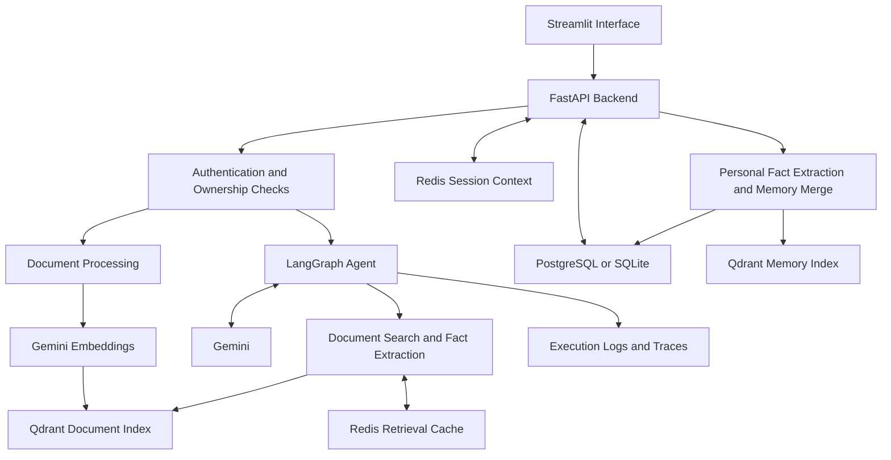

# 🤖 Agent Harness Document AI Chatbot

An AI-powered document analysis and question-answering application built with **Google Gemini, LangGraph, FastAPI, Streamlit, and Qdrant**.

The project combines **Retrieval-Augmented Generation (RAG), structured fact extraction, conversational memory, and controlled tool execution** within an Agent Harness architecture.

> **Agent = Language Model + Tools + Memory + Execution + Guardrails + Observability**

---

## 🚀 Project Overview

This application helps users explore documents through a conversational interface while maintaining traceable sources and optional personal memory.

Users can upload documents, select reference material, ask questions, inspect retrieved excerpts, and explicitly request that the assistant remember information across conversations.

The system separates the interface from the AI backend:

- **Streamlit** handles document uploads, chat interaction, and memory management.
- **FastAPI** handles authentication, document processing, agent execution, and persistence.
- **LangGraph** coordinates model calls and tool execution.
- **Qdrant** stores document vectors for similarity search.
- **PostgreSQL or SQLite** stores document metadata, conversations, messages, and personal facts.
- **Redis**, when configured, caches retrieval results and recent conversation context.

This is a portfolio and learning project focused on building a practical document AI application with explicit control over its surrounding infrastructure.

---

## ✨ Key Features

### 📄 Document Analysis and RAG

- Upload **PDF, TXT, Markdown, PNG, JPG, and JPEG** files.
- Extract readable document text.
- Analyze images using Gemini when needed.
- Optionally analyze all embedded images in a PDF.
- Split content into overlapping chunks.
- Generate embeddings and index document chunks in Qdrant.
- Retrieve relevant content using vector similarity.
- Answer questions about selected documents.
- Preserve document names, page numbers, and retrieved excerpts.
- Display source references for inspection.

### 🛠️ Tool-Based Agent Workflow

- Coordinate reasoning and tool calls through LangGraph.
- Search authorized document collections.
- Extract structured facts from retrieved content.
- Validate tool arguments using defined schemas.
- Restrict tools to an explicit registry.
- Limit tool execution rounds.
- Produce a final response when the tool budget is reached.

### 🧠 Conversational Memory

- Preserve conversation history in relational storage.
- Extract personal facts when memory is enabled and explicitly requested.
- Reuse accepted facts across conversations.
- Avoid duplicate entries for identical facts.
- Keep conflicting information pending until user confirmation.
- Track accepted memory revisions.
- Inspect, accept, reject, or delete memories through the interface.

### 🔒 Access Control and Guardrails

- Authenticate requests using Bearer tokens.
- Associate tokens with user identities.
- Check ownership of documents, conversations, and memories.
- Filter document retrieval by owner and selected document IDs.
- Apply limits to uploads and agent execution.
- Treat retrieved documents as reference data rather than trusted instructions.
- Validate cited source IDs against retrieved sources.

### 📊 Observability

- Assign trace IDs to agent requests.
- Record model and tool execution events.
- Report elapsed processing time.
- Include token usage when returned by the model.
- Display execution details in the interface.
- Log failures for backend diagnosis.

---

## 🛠️ Tech Stack

| Category | Technologies |
|---|---|
| Programming Language | Python 3.11 |
| LLM and Image Understanding | Google Gemini |
| Agent Orchestration | LangGraph |
| LLM Integration | LangChain components |
| Backend API | FastAPI, Uvicorn |
| Data Validation | Pydantic |
| Frontend | Streamlit |
| Relational Storage | PostgreSQL, SQLite, SQLAlchemy |
| Vector Store | Qdrant |
| Embeddings | Gemini Embeddings |
| Cache and Session Context | Redis |
| Document Processing | PyPDF, Pillow |
| Testing | pytest |
| Containerization | Docker, Docker Compose |
| Deployment Configuration | Fly.io |
| Version Control and CI | Git, GitHub, GitHub Actions |

Model names are configurable. Availability, supported features, and usage limits depend on the configured Google project.

---

## 🏗️ System Architecture



### Agent Harness Components

| Component | Responsibility |
|---|---|
| **Language Model** | Generate answers, interpret visual content, and extract structured information |
| **Tools** | Retrieve authorized document content and extract facts |
| **Memory** | Persist conversation history and accepted personal information |
| **Execution Environment** | Run the LangGraph workflow through the FastAPI backend |
| **Guardrails** | Enforce authentication, ownership, input limits, tool limits, and citation checks |
| **Observability** | Record trace IDs, execution events, elapsed time, and usage metadata |

The execution environment runs application workflows. It does not provide arbitrary execution of code generated by the model.

---

## 🔄 Core Workflows

### 1. Document Ingestion

1. Authenticate the user.
2. Validate the uploaded file.
3. Extract text and relevant visual information.
4. Split content into chunks.
5. Generate embeddings.
6. Store vectors and source metadata in Qdrant.
7. Update the document status in relational storage.

For text-based PDFs, full image analysis can remain disabled to reduce additional model calls.

### 2. Document Question Answering

1. Verify conversation and document ownership.
2. Load recent conversation history.
3. Load accepted personal facts.
4. Run the LangGraph agent.
5. Retrieve relevant document chunks when the agent calls a search tool.
6. Generate an answer using the available context.
7. Validate cited source IDs.
8. Save the conversation turn and source references.

Uploading a file and selecting it for a question are separate actions.

### 3. Fact Extraction and Memory Merge

When personal memory is enabled:

| Incoming Information | Behavior |
|---|---|
| New fact | Create a memory entry |
| Identical fact | Keep the existing value |
| Conflicting fact | Store a pending value for confirmation |
| Accepted update | Replace the current value and record a revision |
| Rejected update | Keep the current value |
| Delete request | Remove the memory record and attempt vector cleanup |

Personal memory extraction is separate from document fact extraction. Document content should not automatically become a personal fact about the user.

Relational storage holds the authoritative memory values. Qdrant memory indexing is implemented, but synchronization and retrieval integration have limitations described below.

---

## 📂 Project Structure

```text
chatbot/
├── app.py                       # Streamlit interface
├── requirements.txt             # Python dependencies
├── .env.example                 # Environment configuration template
├── .gitignore
├── .dockerignore
├── Dockerfile
├── compose.yaml                 # API, UI, PostgreSQL, Qdrant, Redis
├── fly.toml                     # Backend deployment configuration
├── fly.ui.toml                  # UI deployment configuration
├── pytest.ini
├── README.md
│
├── backend/
│   ├── __init__.py
│   ├── main.py                  # FastAPI application and lifecycle
│   ├── config.py                # Settings and environment loading
│   ├── auth.py                  # Bearer-token authentication
│   ├── database.py              # SQL engine and session management
│   ├── models.py                # Relational data models
│   ├── schemas.py               # Request and response schemas
│   │
│   ├── api/
│   │   ├── __init__.py
│   │   ├── deps.py              # Ownership and operation dependencies
│   │   ├── documents.py         # Upload, list, and delete documents
│   │   ├── conversations.py     # Conversations and message history
│   │   ├── chat.py              # Agent execution endpoint
│   │   └── memories.py          # Memory management endpoints
│   │
│   ├── agent/
│   │   ├── __init__.py
│   │   ├── prompts.py           # Runtime instructions
│   │   ├── state.py             # Graph state
│   │   ├── tools.py             # Tool definitions
│   │   ├── graph.py             # LangGraph workflow
│   │   └── guardrails.py        # Input and citation validation
│   │
│   └── services/
│       ├── __init__.py
│       ├── gemini.py            # LLM, embeddings, and image processing
│       ├── ingestion.py         # Document parsing and chunking
│       ├── vectors.py           # Qdrant operations
│       ├── cache.py             # Retrieval cache
│       ├── sessions.py          # Recent conversation context
│       ├── facts.py             # Fact extraction support
│       ├── memory.py            # Memory merge and revisions
│       └── observability.py     # Execution traces
│
├── tests/
│   ├── __init__.py
│   ├── conftest.py
│   ├── mocks.py
│   ├── test_auth.py
│   ├── test_documents.py
│   ├── test_retrieval.py
│   ├── test_memory.py
│   └── test_agent.py
│
└── .github/
    └── workflows/
        └── ci.yml
```

Local credentials, uploaded files, databases, and Python environments should remain outside version control.

---

## ⚙️ Installation

### Requirements

- Python 3.11
- A Google Gemini API key
- A generation model available to your Google project
- Docker and Docker Compose for the containerized configuration

### 1. Clone the Repository

```bash
git clone https://github.com/trongquy1811/chatbot.git
cd chatbot
```

### 2. Create a Virtual Environment

**Windows PowerShell**

```powershell
py -3.11 -m venv .venv
.\.venv\Scripts\python.exe -m pip install --upgrade pip
.\.venv\Scripts\python.exe -m pip install -r requirements.txt
```

**Linux / macOS**

```bash
python3.11 -m venv .venv
source .venv/bin/activate
python -m pip install --upgrade pip
python -m pip install -r requirements.txt
```

### 3. Create the Environment File

If `.env` does not already exist:

**Windows**

```powershell
Copy-Item .env.example .env
```

**Linux / macOS**

```bash
cp .env.example .env
```

Do not overwrite an existing `.env` containing your configuration.

---

## 🔑 Configuration

Edit `.env` and configure the required credentials:

```dotenv
# Google AI
GOOGLE_API_KEY=your_google_api_key
GEMINI_MODEL=your_available_generation_model
EMBEDDING_MODEL=models/gemini-embedding-001

# Application authentication
API_KEYS_JSON='{"replace_with_a_private_random_token_at_least_24_characters":"quy"}'

# Local relational storage
DATABASE_URL=sqlite:///./data/docanalyzer.db
DATA_DIR=data

# Qdrant: leave URL empty for local storage
QDRANT_URL=
QDRANT_API_KEY=
QDRANT_COLLECTION=documents_v1
QDRANT_MEMORY_COLLECTION=memories_v1

# Optional Redis for local development
REDIS_URL=

# UI connection
API_BASE_URL=http://127.0.0.1:8000

# Docker Compose PostgreSQL password
POSTGRES_PASSWORD=replace_with_a_strong_password

# Processing limits
MAX_UPLOAD_MB=10
MAX_PDF_PAGES=30
MAX_CHUNKS=500
MAX_TOOL_ROUNDS=3
LLM_TIMEOUT=45
MAX_RETRIES=1
OCR_PDF_IMAGES=false
```

Replace `your_available_generation_model` with a model that supports the application's generation, tool-calling, and structured-output requirements.

### Generate an Application Access Token

```powershell
.\.venv\Scripts\python.exe -c "import secrets; print(secrets.token_urlsafe(32))"
```

Use the generated value as the token key inside `API_KEYS_JSON`.

### Credential Roles

| Setting | Purpose |
|---|---|
| `GOOGLE_API_KEY` | Allows the backend to call Gemini |
| `API_KEYS_JSON` | Maps application Access tokens to user identities |
| `QDRANT_API_KEY` | Authenticates access to a protected Qdrant service |
| `POSTGRES_PASSWORD` | Configures PostgreSQL in Docker Compose |

The application Access token is not the Gemini API key.

The local interface can prefill an application token from `.env` when configured for local use. Disable automatic prefilling before exposing the UI to public visitors.

---

## ▶️ Run Locally

The default local configuration uses **SQLite and Qdrant local storage**. Redis remains optional.

### Terminal 1: Backend

Run from the repository root:

```powershell
.\.venv\Scripts\python.exe -m uvicorn backend.main:app --host 127.0.0.1 --port 8000
```

Keep this terminal running.

### Terminal 2: Interface

```powershell
$env:API_BASE_URL = "http://127.0.0.1:8000"
.\.venv\Scripts\python.exe -m streamlit run app.py
```

For Linux or macOS:

```bash
# Terminal 1
python -m uvicorn backend.main:app --host 127.0.0.1 --port 8000

# Terminal 2
API_BASE_URL=http://127.0.0.1:8000 python -m streamlit run app.py
```

### Local Addresses

| Service | Address |
|---|---|
| Streamlit UI | http://localhost:8501 |
| API Documentation | http://127.0.0.1:8000/docs |
| Health Check | http://127.0.0.1:8000/health |
| Readiness Check | http://127.0.0.1:8000/ready |

Run only one backend process against a Qdrant local storage directory.

---

## 🐳 Run with Docker Compose

Docker Compose provides the following services:

| Service | Responsibility |
|---|---|
| `api` | FastAPI backend |
| `ui` | Streamlit interface |
| `postgres` | Relational persistence |
| `qdrant` | Vector storage |
| `redis` | Retrieval cache and session context |

Configure `.env`, then start the stack:

```bash
docker compose up --build -d
```

Compose overrides the API's local storage URLs to connect to PostgreSQL, Qdrant, and Redis inside the container network.

The UI connects to the backend using:

```text
http://api:8000
```

Inspect service status and logs:

```bash
docker compose ps
docker compose logs -f api
```

Stop the stack:

```bash
docker compose down
```

Named volumes preserve SQL data, vector data, and uploaded originals. Adding `-v` to the shutdown command deletes the named volumes.

---

## 💬 Usage

### Document Question Answering

1. Authenticate with an application Access token.
2. Upload a supported document.
3. Wait until processing completes.
4. Select the document under **Documents for this question**.
5. Submit a question.
6. Inspect the answer and source references.

Example questions:

```text
Summarize the main content of this document.

What technologies are used in the project?

Extract the important dates and explain their context.

What conclusions are supported by the document?
```

For PDFs with readable text, leave full image analysis disabled unless the question requires visual content.

### Personal Memory

Enable the memory option and submit:

```text
Please remember that my name is Quy.
```

Verify the saved entry in the Memory tab.

Create a new conversation and ask:

```text
What is my name?
```

To test conflict handling:

```text
Please update my name to Nguyen Trong Quy.
```

Inspect the pending value in the Memory tab, then accept or reject it.

An assistant acknowledgment does not by itself confirm successful persistence. Check the stored memory entry.

---

## 🌐 API Reference

Authenticated endpoints use:

```http
Authorization: Bearer <application_access_token>
```

| Method | Endpoint | Description |
|---|---|---|
| GET | `/health` | Application liveness |
| GET | `/ready` | SQL and Qdrant connectivity check |
| GET | `/auth/verify` | Verify Access token |
| POST | `/documents` | Upload and process a document |
| GET | `/documents` | List owned documents |
| DELETE | `/documents/{document_id}` | Delete an owned document |
| POST | `/conversations` | Create a conversation |
| GET | `/conversations` | List owned conversations |
| GET | `/conversations/{conversation_id}/messages` | Retrieve message history |
| POST | `/chat` | Run the agent |
| GET | `/memories` | List personal memories |
| POST | `/memories/{memory_id}/resolve` | Accept or reject a pending update |
| DELETE | `/memories/{memory_id}` | Delete a memory |

Example chat request:

```json
{
  "question": "Summarize the selected document.",
  "conversation_id": "<conversation_id>",
  "document_ids": ["<document_id>"],
  "remember": false
}
```

See `/docs` for complete request and response schemas.

The readiness endpoint does not validate Gemini availability or remaining quota.

---

## 🧪 Testing and Continuous Integration

Run the tests:

```powershell
.\.venv\Scripts\python.exe -m pytest tests -v
```

The test suite includes coverage for:

- Authentication behavior
- Protected routes
- Document upload, listing, and deletion
- Retrieval operations
- Cache fallback behavior
- Agent execution and citation checks
- Memory creation, conflicts, resolution, and deletion

AI substitutes are used in test fixtures to avoid live Gemini calls.

GitHub Actions is configured to run the test suite on pushes and pull requests targeting `main`.

Check the actual test output and CI results for the current commit. Mock-based tests do not establish live-service availability or deployment correctness.

---

## ☁️ Fly.io Deployment

The repository includes separate deployment configurations:

| File | Target |
|---|---|
| `fly.toml` | FastAPI backend |
| `fly.ui.toml` | Streamlit interface |

Before deployment:

- Choose unique application names.
- Configure credentials through deployment secrets.
- Set the UI's `API_BASE_URL` to the backend HTTPS address.
- Configure PostgreSQL, Qdrant, and Redis connections.
- Verify volume ownership and write permissions.
- Use Qdrant server for shared or multi-process access.
- Verify startup commands, health checks, and persistent storage.
- Disable local automatic token prefilling for public access.

Configuration files are provided as a starting point. A successful live deployment is not implied.

---

## 🔍 Troubleshooting

| Issue | Explanation and Action |
|---|---|
| Connection refused / WinError 10061 | Start the backend and verify the configured host and port |
| `401 Unauthorized` | Check the application token and restart the backend after configuration changes |
| Qdrant storage already accessed | Stop the other process using the local storage directory |
| Gemini `404 NOT_FOUND` | Verify model availability for the configured project |
| Gemini `503 UNAVAILABLE` | The upstream AI service is temporarily unavailable |
| Gemini `429 RESOURCE_EXHAUSTED` | Inspect the quota metric and retry delay |
| Generic API `502` | Find the corresponding trace ID in backend logs |
| Answer saved but memory failed | The later extraction or memory update failed after the answer was saved |
| Slow PDF processing | Disable full image analysis when readable text is sufficient |
| No document context | Select a processed document before submitting the question |

Repeated short retries do not resolve an exhausted daily quota. Creating another API key in the same Google project does not reset that project's quota.

---

## ⚠️ Current Limitations

- AI requests depend on model availability and project quotas.
- Some upstream errors are currently returned as generic `502` responses.
- Chat currently loads personal facts from SQL rather than using semantic memory retrieval.
- Qdrant memory revisions need stable point IDs to prevent older vector entries from accumulating.
- SQL and Qdrant updates are not atomic; automated synchronization recovery is not yet implemented.
- Blocking document processing inside the asynchronous upload handler needs to be moved off the event loop.
- The operation lock coordinates one backend process, not multiple workers.
- Citation validation checks source IDs rather than proving every generated claim.
- Prompt guardrails reduce risk but cannot guarantee complete resistance to malicious content.
- Database migrations and broader live-service integration checks remain future work.

---

## 🔮 Future Improvements

- Quota-aware error responses and retry handling
- Stable vector IDs and recoverable memory synchronization
- Semantic memory retrieval validated against SQL records
- Background document processing
- Database migrations
- Hybrid retrieval and reranking
- Retrieval and answer-quality evaluation
- Expanded ownership and isolation tests
- Live-service integration tests
- Verified Fly.io deployment
- Centralized monitoring and metrics

---

## 👨‍💻 Author

**Nguyen Trong Quy**

Computer Science Graduate · AI Engineering Portfolio

- GitHub: [@trongquy1811](https://github.com/trongquy1811)
- Repository: [Agent Harness Document AI Chatbot](https://github.com/trongquy1811/chatbot)

---

## 📄 License

This project is developed for educational and portfolio purposes.

No standalone license is currently declared. Add a `LICENSE` file to define reuse and distribution terms.